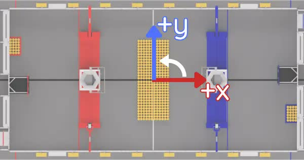
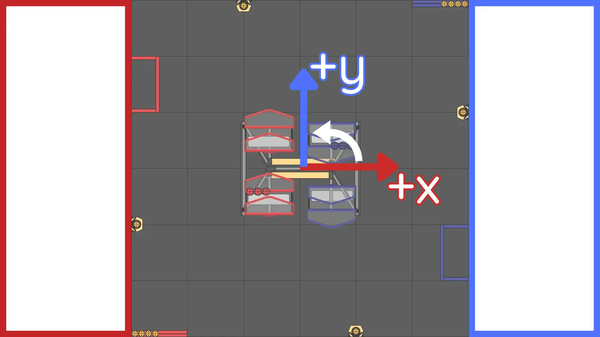
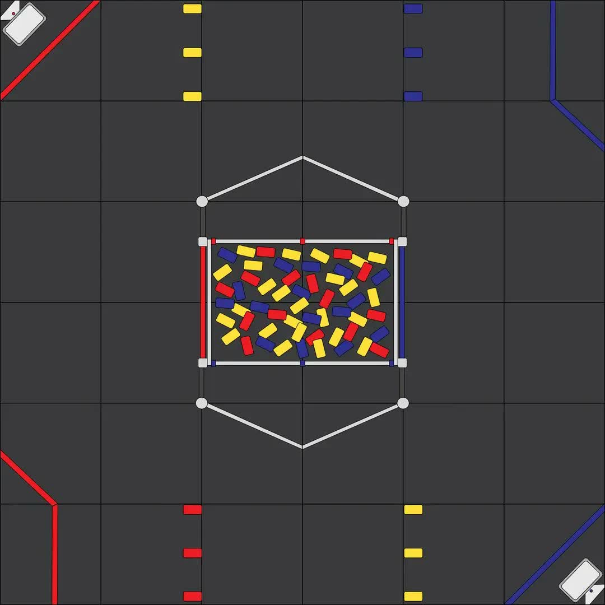
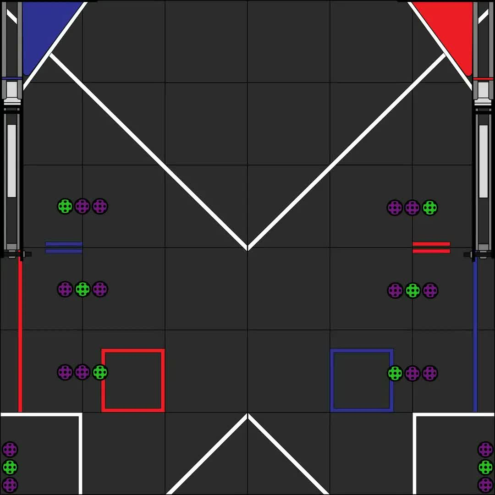

# Coordinate System

Coordinate systems are used in FRC and FTC programming in several places. A few of the common places are: robot movement, joystick input, :term:`pose` estimation, AprilTags, and path planning.

It is important to understand the basics of the coordinate system used throughout WPILib and other common tools for programming a robot, such as PathPlanner. Many teams intuitively  think of a coordinate system that is different from what is used in WPILib, and this leads to problems that need to be tracked down throughout the season. It is worthwhile to take a few minutes to understand the coordinate system, and come back here as a reference when programming. It's not very difficult to get robot movement with a joystick working without getting the coordinate system right, but it will be much more difficult to build on code using a different coordinate system to add :term:`pose estimation` with :term:`AprilTags` and path planning for autonomous.

## WPILib coordinate system

In most cases, WPILib uses the NWU axes convention (North-West-Up as external reference in the world frame.) In the NWU axes convention, where the positive X axis points ahead, the positive Y axis points left, and the positive Z axis points up referenced from the floor. When viewed with each positive axis pointing toward you, counter-clockwise (CCW) is a positive value and clockwise (CW) is a negative value.

.. figure:: images/coordinate-system/robot-3d.svg
   :scale: 200
   :alt: NWU axes convention in three dimensions

   Robot coordinate system in three dimensions

The figure above shows the coordinate system in relation to a robot. The figure below shows this same coordinate system when viewed from the top (with the Z axis pointing toward you.) This is how you can think of the robot's coordinates in 2D.

.. figure:: images/coordinate-system/robot-2d.svg
   :scale: 200
   :alt: NWU axes convention in two dimensions

   Robot coordinate system in two dimensions

## Rotation conventions

In most cases in WPILib programming, 0° is aligned with the positive X axis, and 180° is aligned with the negative X axis. CCW rotation is positive, so 90° is aligned with the positive Y axis, and -90° is aligned with the negative Y axis.

.. figure:: images/coordinate-system/rotation.svg
   :scale: 200
   :alt: Unit circle

   Unit circle with common angles

The figure above shows the unit circle with common angles labeled in degrees (°) and radians (rad). Notice that rotation to the right is negative, and the range for the whole unit circle is -180° to 180° (-Pi radians to Pi radians).

.. note:: The range is (-180, 180], meaning it is exclusive of -180° and inclusive of 180°.

There are some places you may choose to use a different range, such as 0° to 360° or 0 to 1 rotation, but be aware that many core WPILib classes and FRC tools are built with the unit circle above.

.. warning:: Some :term:`gyroscope` and :term:`IMU` models use CW positive rotation, such as the NavX IMU. Care must be taken to handle rotation properly, sensor values may need to be inverted. Read the documentation and verify that rotation is CCW positive.

.. warning:: Many sensors that read rotation around an axis, such as encoders and IMU's, read continuously. This means they read more than one rotation, so when rotating past 180° they read 181°, not -179°. Some sensors have configuration settings where you can choose their wrapping behavior and range, while others need to be handled in your code. Careful attention should be paid to make sure sensor readings are consistent and your control loop handles wrapping in the same way as your sensor.

## Joystick and controller coordinate system

Joysticks, including the sticks on controllers, don't use the same NWU coordinate system. They use the NED (North-East-Down) convention, where the positive X axis points ahead, the positive Y axis points right, and the positive Z axis points down. When viewed with each positive axis pointing toward you, counter-clockwise (CCW) is a positive value and clockwise (CW) is a negative value.

.. figure:: images/coordinate-system/joystick-3d.svg
   :scale: 200
   :alt: NED axes convention

   Joystick coordinate system

It's important to note that joystick input values are rotations around an axis, not translations. In practical terms, this means:

- pushing forward on the joystick (toward the positive X axis) is a CW rotation around the Y axis, so you get a negative Y value.
- pushing to the right (toward the positive Y axis) is a CCW rotation around the X axis, so you get a positive X value.
- twisting the joystick CW (toward the positive Y axis) is a CCW rotation around the Z axis, so you get a positive Z value.

## Using Joystick and controller input to drive a robot

You may have noticed, the coordinate system used by WPILib for the robot is not the same as the coordinate system used for joysticks and controllers. Care needs to be taken to understand the difference, and properly pass driver input to the drive subsystem.

### Differential drivetrain example

Differential drivetrains are non-holonomic, which means the robot drivetrain cannot move side-to-side (strafe). This type of drivetrain can move forward and backward along the X axis, and rotate around the Z axis. Consider a common arcade drive scheme using a single joystick where the driver pushes the joystick forward/backward for forward/backward robot movement, and push the joystick left/right to rotate the robot left/right.

The code snippet below uses the ``DifferentialDrive`` and ``Joystick`` classes to drive the robot with the arcade scheme described above. ``DifferentialDrive`` uses the robot coordinate system defined above, and ``Joystick`` uses the joystick coordinate system.

.. tab-set-code::

    ```java
    public void teleopPeriodic() {
        // Arcade drive with a given forward and turn rate
        myDrive.arcadeDrive(-driveStick.getY(), -driveStick.getX());
    }
    ```

    ```c++
    void TeleopPeriodic() override {
        // Arcade drive with a given forward and turn rate
        myDrive.ArcadeDrive(-driveStick.GetY(), -driveStick.GetX());
    }
    ```

    ```python
    def teleop_periodic(self):
        # Arcade drive with a given forward and turn rate
        self.myDrive.arcade_drive(-self.driveStick.get_y(), -self.driveStick.get_x())
    ```

The code calls the ``DifferentialDrive.arcadeDrive(xSpeed, zRotation)`` method, with values it gets from the ``Joystick`` class:

- The first argument is ``xSpeed``
   - Robot: ``xSpeed`` is the speed along the robot's X axis, which is forward/backward.
   - Joystick: The driver sets forward/backward speed by rotating the joystick along its Y axis, which is pushing the joystick forward/backward.
   - Code: Moving the joystick forward is negative Y rotation, whereas moving the robot forward is along the positive X axis. This means the joystick value needs to be inverted by placing a - (minus sign) in front of the value.

- The second argument is ``zRotation``
   - Robot: ``zRotation`` is the speed of rotation along the robot's Z axis, which is rotating left/right.
   - Joystick: The driver sets rotation speed by rotating the joystick along its X axis, which is pushing the joystick left/right.
   - Code: Moving the joystick to the right is positive X rotation, whereas robot rotation is CCW positive. This means the joystick value needs to be inverted by placing a - (minus sign) in front of the value.

### Mecanum drivetrain example

Mecanum drivetrains are holonomic, meaning they have the ability to move side-to-side. This type of drivetrain can move forward/backward and rotate around the Z axis like differential drivetrains, but it can also move side-to-side along the robot's Y axis. Consider a common arcade drive scheme using a single joystick where the driver pushes the joystick forward/backward for forward/backward robot movement, pushes the joystick left/right to move side-to-side, and twists the joystick to rotate the robot.

.. tab-set-code::

    ```java
    public void teleopPeriodic() {
        // Drive using the X, Y, and Z axes of the joystick.
        m_robotDrive.driveCartesian(-m_stick.getY(), -m_stick.getX(), -m_stick.getZ());
    }
    ```

    ```c++
    void TeleopPeriodic() override {
        // Drive using the X, Y, and Z axes of the joystick.
        m_robotDrive.driveCartesian(-m_stick.GetY(), -m_stick.GetX(), -m_stick.GetZ());
    }
    ```

    ```python
    def teleop_periodic(self):
        // Drive using the X, Y, and Z axes of the joystick.
        self.robot_drive.drive_cartesian(-self.stick.get_y(), -self.stick.get_x(), -self.stick.get_z())
    ```

The code calls the ``MecanumDrive.driveCartesian(xSpeed, ySpeed, zRotation)`` method, with values it gets from the ``Joystick`` class:

- The first argument is ``xSpeed``
   - Robot: ``xSpeed`` is the speed along the robot's X axis, which is forward/backward.
   - Joystick: The driver sets forward/backward speed by rotating the joystick along its Y axis, which is pushing the joystick forward/backward.
   - Code: Moving the joystick forward is negative Y rotation, whereas robot forward is along the positive X axis. This means the joystick value needs to be inverted by placing a - (minus sign) in front of the value.


- The second argument is ``ySpeed``
   - Robot: ``ySpeed`` is the speed along the robot's Y axis, which is left/right.
   - Joystick: The driver sets left/right speed by rotating the joystick along its X axis, which is pushing the joystick left/right.
   - Code: Moving the joystick to the right is positive X rotation, whereas robot right is along the negative Y axis. This means the joystick value needs to be inverted by placing a - (minus sign) in front of the value.

- The third argument is ``zRotation``
   - Robot: ``zRotation`` is the speed of rotation along the robot's Z axis, which is rotating left/right.
   - Joystick: The driver sets rotation speed by twisting the joystick along its Z axis, which is twisting the joystick left/right.
   - Code: Twisting the joystick to the right is positive Z rotation, whereas robot rotation is CCW positive. This means the joystick value needs to be inverted by placing a - (minus sign) in front of the value.

### Swerve drivetrain example

Like mecanum drivetrains, swerve drivetrains are holonomic and have the ability to move side-to-side. Joystick control can be handled the same way for all holonomic drivetrains, but WPILib doesn't have a built-in robot drive class for swerve. Swerve coding is described in other sections of this documentation, but an example of using joystick input to set ``ChassisSpeeds`` values is included below. Consider the same common arcade drive scheme described in the mecanum section above. The scheme uses a single joystick where the driver pushes the joystick forward/backward for forward/backward robot movement, pushes the joystick left/right to move side-to-side, and twists the joystick to rotate the robot.

.. tab-set-code::

   ```java
   // Drive using the X, Y, and Z axes of the joystick.
   var speeds = new ChassisSpeeds(-m_stick.getY(), -m_stick.getX(), -m_stick.getZ());
   ```

   ```c++
   // Drive using the X, Y, and Z axes of the joystick.
   wpi::ChassisSpeeds speeds{-m_stick.GetY(), -m_stick.GetX(), -m_stick.GetZ()};
   ```

   ```python
   # Drive using the X, Y, and Z axes of the joystick.
   speeds = ChassisSpeeds(-self.stick.get_y(), -self.stick.get_x(), -self.stick.get_z())
   ```

The three arguments to the ``ChassisSpeeds`` constructor are the same as ``driveCartesian`` in the mecanum section above; ``xSpeed``, ``ySpeed``, and ``zRotation``. See the description of the arguments, and their joystick input in the section above.

## Robot drive kinematics

:doc:`Kinematics is a topic that is covered in a different section </docs/software/kinematics-and-odometry/intro-and-chassis-velocities>`, but it's worth discussing here in relation to the coordinate system. It is critically important that kinematics is configured using the coordinate system described above. Kinematics is a common starting point for coordinate system errors that then cascade to basic drivetrain control, field oriented driving, pose estimation, and path planning.

When you construct a ``SwerveDriveKinematics`` or ``MecanumDriveKinematics`` object, you specify a translation from the center of your robot to each wheel. These translations use the coordinate system above, with the origin in the center of your robot.

.. figure:: images/coordinate-system/kinematics.svg
   :alt: Kinematics with translation signs

   Kinematics with translation signs

For the robot in the diagram above, let's assume the distance between the front and rear wheels (wheelbase) is 2'. Let's also assume the distance between the left and right wheels (trackwidth) is also 2'. Our translations (x, y) would be like this:

- Front left: (1', 1')
- Front right: (1', -1')
- Rear left: (-1', 1')
- Rear right: (-1', -1')

.. warning:: A common error is to use an incorrect coordinate system where the positive Y axis points forward on the robot. The correct coordinate system has the positive X axis pointing forward.

## Field coordinate systems

The field coordinate system (or global coordinate system) is an absolute coordinate system where a point on the field is designated as the origin. Two common uses of the field coordinate system will be explored in this document:

- Field oriented driving is a drive scheme for holonomic drivetrains, where the driver moves the controls relative to their perspective of the field, and the robot moves in that direction regardless of where the front of the robot is facing. For example, a driver on the red alliance pushes the joystick forward, the robot will move downfield toward the blue alliance wall, even if the robot's front is facing the driver.
- Pose estimation with odometry and/or AprilTags are used to estimate the robot's pose on the field.

### Field-centered origin

Starting with 2027, WPILib uses a single field coordinate system for all field-relative poses (``Pose2d`` and ``Pose3d``) in both FIRST Robotics Competition (FRC) and FIRST Tech Challenge (FTC), regardless of your alliance color:

- The origin is at the center of the field, on the floor.
- The positive X axis points toward the blue alliance wall.
- The positive Y axis points left when facing positive X.
- The positive Z axis points up.
- A rotation of 0° faces positive X, and positive rotation is counter-clockwise (CCW) when viewed from above.

For a field of length L (alliance wall to alliance wall) and width W, X ranges from -L/2 to L/2, and Y ranges from -W/2 to W/2. Field images in tools such as Glass show the blue alliance wall on the right and the red alliance wall on the left, so positive X points to the right and positive Y points up on the screen. The figures below show the same coordinate system on an FRC field and an FTC field.



   WPILib field coordinate system, shown on the FRC 2026 REBUILT field [#]_



   WPILib field coordinate system, shown on the FTC 2026-2027 BIOBUZZ field [#]_

The built-in field layouts and AprilTag layouts provided by WPILib, for both FRC and FTC and including layouts from prior seasons, use this coordinate system.

.. warning:: This is a change from earlier conventions in both programs. Poses published to NetworkTables or logged to a DataLog do not record which coordinate system they use, so dashboards, tools, and code that were written for earlier seasons need to be updated.

   - **FRC (2026 and prior seasons):** The origin was at the right-hand corner of the blue alliance wall (when facing the field) and the positive X axis pointed away from the blue alliance wall. Field-relative X and Y values and headings are rotated 180° from the new convention.
   - **FTC (2026 and prior seasons):** The origin was already at the center of the field, but the axes were defined relative to the Red Wall. Positive Y ran away from the Red Wall (toward the blue alliance in a square field), and positive X ran parallel to the Red Wall, increasing to the right when viewed from the Red Wall. Field-relative values are rotated 90° from the new convention.

.. note:: To convert a field-relative pose from the previous convention to the new convention:

   - **FRC**, with field length L and field width W: ``x = L/2 - oldX``, ``y = W/2 - oldY``, and ``heading = oldHeading + 180°``.
   - **FTC**: ``x = oldY``, ``y = -oldX``, and ``heading = oldHeading - 90°``.

   Field-relative velocities and accelerations are converted the same way as positions (without the offsets), and angular velocity is unchanged. Robot-relative geometry, such as the translations from the center of the robot to the wheels or the transform from the robot to a camera, does not change.

When initializing a pose estimator or odometry, the initial pose must be in this coordinate system. This is especially important when using AprilTag vision-based pose estimators, as the AprilTag layouts also use this system.

### Mirrored field vs. rotated field

Historically, FRC and FTC have used two types of field layouts in relation to the red and blue alliance.

Games such as FRC Rapid React in 2022 and FTC Into The Deep in 2024-2025 used a rotated layout. A rotated layout means that, from your perspective from behind your alliance wall, your field elements and your opponent's elements are in the same location. Notice in the Rapid React field layout diagram below, whether you are on the red or blue alliance, your human player station is on your right and your hanger is on your left.

.. figure:: images/coordinate-system/rapid-react-field.jpg
   :alt: Rotated Rapid React field from 2022

   Rotated field from FRC RAPID REACT in 2022 [#]_

The FTC INTO THE DEEP field below is also rotated. Rotating the field 180° about its center swaps the red and blue alliance elements.



   Rotated field from FTC INTO THE DEEP in 2024-2025 [#]_

Games such as FRC CHARGED UP in 2023 and CRESCENDO in 2024 and FTC DECODE in 2025-2026 used a mirrored layout. A mirrored layout means that the red and blue alliance layout are mirrored across the centerpoint of the field. Refer to the CHARGED UP field diagram below. When you are standing behind the blue alliance wall, the charge station is on the right side of the field from your perspective. However, standing behind the red alliance wall, the charge station is on the left side of the field from your perspective.

.. figure:: images/coordinate-system/charged-up-field.jpg
   :alt: Mirrored CHARGED UP field from 2023

   Mirrored field from FRC CHARGED UP in 2023 [#]_

The FTC DECODE field below is also mirrored. The red and blue alliance goals and zones are reflections of each other across the center line of the field.



   Mirrored field from FTC DECODE in 2025-2026 [#]_

### Dealing with red or blue alliance

Because the field coordinate system doesn't change with your alliance, AprilTags and other field elements are always at the same coordinates, and pose estimation needs no special logic for your alliance. Many of the tools and libraries used in FRC, such as Glass and the Field2d widget, use the same convention.

.. warning:: There are cases where your alliance may change (or appear to change) after the code is initialized. When you are not connected to the :term:`FMS` at a competition, you can change your alliance station in the Driver Station application at any time. Even when you are at a competition, your robot will usually initialize before connecting to the FMS so you will not have alliance information.

.. note:: At competition events, the FMS will automatically report your Team Station and alliance color. When you are not connected to an FMS, you can choose your Team Station and alliance color on the Driver Station :ref:`docs/software/firstdriverstation/first-driver-station-introduction:Settings Tab`.

Field oriented driving needs to consider the alliance color, because the driver's perspective changes. The blue alliance wall is at positive X. When your alliance is red and the driver is standing behind the red alliance wall, they will want the robot to move downfield toward the blue alliance wall, which is the positive X direction. However, when your alliance is blue, the driver will want the robot to go downfield toward the red alliance wall, which is the negative X direction.

A simple way to deal with field oriented driving is to check the alliance color reported by the ``MatchState`` class, and invert the driver's controls when your alliance is blue. As noted above, your alliance color can change so it needs to be checked on every robot iteration.

Similarly, the robot's starting orientation depends on the alliance. A robot that starts a match facing the opposing alliance wall faces positive X (0°) on the red alliance and negative X (180°) on the blue alliance, so the starting pose and gyro reset need to take this into account.

Swerve:

.. tab-set-code::

   ```java
    // +X points toward the blue alliance wall. When our alliance is blue, X and Y need to be inverted
    var alliance = MatchState.getAlliance();
    var invert = 1;
    if (alliance.isPresent() && alliance.get() == Alliance.BLUE) {
      invert = -1;
    }

    // Create field-relative ChassisVelocities for controlling Swerve
    var chassisVelocities =
        new ChassisVelocities(xSpeed * invert, ySpeed * invert, zRotation)
            .toRobotRelative(gyroAngle);
   ```

   ```c++
    // +X points toward the blue alliance wall. When our alliance is blue, X and
    // Y need to be inverted
    int invert = 1;
    if (wpi::MatchState::GetAlliance().value_or(wpi::Alliance::RED) ==
        wpi::Alliance::BLUE) {
      invert = -1;
    }

    // Create field-relative ChassisVelocities for controlling Swerve
    wpi::math::ChassisVelocities chassisVelocities{
        wpi::units::meters_per_second_t{xSpeed * invert},
        wpi::units::meters_per_second_t{ySpeed * invert},
        wpi::units::radians_per_second_t{zRotation}};
   ```

   ```python
        # +X points toward the blue alliance wall. When our alliance is blue, X and Y need to be inverted
        invert = 1
        if wpilib.MatchState.get_alliance() == wpilib.Alliance.BLUE:
            invert = -1

        # Create field-relative ChassisVelocities for controlling Swerve
        chassis_velocities = wpimath.ChassisVelocities(
            x_speed * invert, y_speed * invert, z_rotation
        ).to_robot_relative(gyro_angle)
   ```

Mecanum:

.. tab-set-code::

   ```java
    // +X points toward the blue alliance wall. When our alliance is blue, X and Y need to be inverted
    var alliance = MatchState.getAlliance();
    var invert = 1;
    if (alliance.isPresent() && alliance.get() == Alliance.BLUE) {
      invert = -1;
    }
    // Drive using the X, Y, and Z axes of the joystick.
    robotDrive.driveCartesian(xSpeed * invert, ySpeed * invert, zRotation, gyroAngle);
   ```

   ```c++
    // +X points toward the blue alliance wall. When our alliance is blue, X and
    // Y need to be inverted
    int invert = 1;
    if (wpi::MatchState::GetAlliance().value_or(wpi::Alliance::RED) ==
        wpi::Alliance::BLUE) {
      invert = -1;
    }
    // Control a mecanum drivetrain
    robotDrive.DriveCartesian(xSpeed * invert, ySpeed * invert, zRotation,
                              gyroAngle);
   ```

   ```python
        # +X points toward the blue alliance wall. When our alliance is blue, X and Y need to be inverted
        invert = 1
        if wpilib.MatchState.get_alliance() == wpilib.Alliance.BLUE:
            invert = -1

        robot_drive.drive_cartesian(
            x_speed * invert, y_speed * invert, z_rotation, gyro_angle
        )
   ```

.. todo:: Change to RLIs when https://github.com/wpilibsuite/allwpilib/pull/9501 is merged

#### Alliance-relative origins

Some teams choose to define the origin of the field based on their alliance, so the positive X axis always points away from their alliance wall. This is not recommended, because it adds complications, especially in years when the field layout is mirrored between alliances:

- Your alliance color can change after initialization. If your robot has seen a tag and used it for pose estimation, you will need to adjust your origin and reset your estimated pose.
- AprilTag layouts, the Glass and Field2d widgets, and other tools use the field-centered origin described above. Special handling is needed to convert your pose to the field-centered coordinate system before using a tag layout or sending the pose to a dashboard.

.. [#] REBUILT field image based on the field image from Juniormunk on Chiefdelphi `<https://www.chiefdelphi.com/t/2026-rebuilt-high-resolution-field-image/510611>`__
.. [#] BIOBUZZ field image based on the field images from u/kidsonfilms on Reddit `<https://www.reddit.com/r/FTC/comments/1weleaj/biobuzz_custom_field_images_meepmeep_compatible/>`__
.. [#] Rapid React field image from MikLast on Chiefdelphi `<https://www.chiefdelphi.com/t/2022-top-down-field-renders/399031>`__
.. [#] INTO THE DEEP field image based on the field images from u/kidsonfilms on Reddit `<https://www.reddit.com/r/FTC/comments/1fbhxka/into_the_deep_meepmeep_custom_field_images/>`__
.. [#] CHARGED UP field image from MikLast on Chiefdelphi `<https://www.chiefdelphi.com/t/2023-top-down-field-renders/421365>`__
.. [#] DECODE field image based on the field images from u/kidsonfilms on Reddit `<https://www.reddit.com/r/FTC/comments/1nalob0/decode_custom_field_images_meepmeep_compatible/>`__
