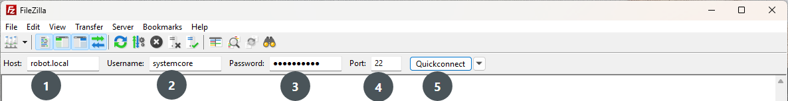
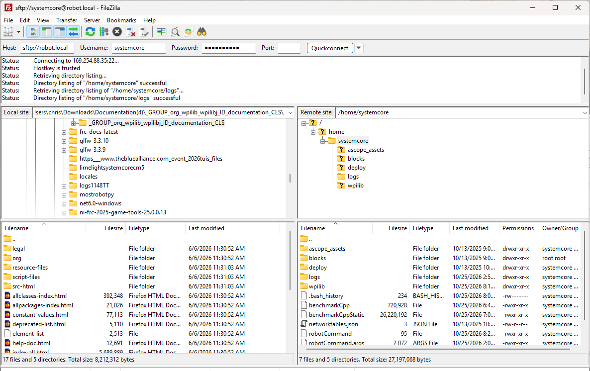

# Systemcore SFTP

.. note:: The Systemcore has SFTP  enabled. This article describes how to use SFTP to access the systemcore file system.

## SFTP
SFTP is the recommended way to access the Systemcore file system. Because you will be using the same account that your program will run under, files copied over should always have permissions compatible with your code.

### Software
There are a number of freely available programs for SFTP. This article will discuss using FileZilla. You can either download and install [FileZilla](https://filezilla-project.org/download.php?show_all=1) before proceeding or extrapolate the directions below to your SFTP client of choice.

### Connecting to the Systemcore

To connect to your Systemcore:

1. Enter the mDNS name ``robot.local`` in the :guilabel:`Host` box
2. Enter ``systemcore`` in the :guilabel:`Username` box (this is the account your program runs under)
3. Enter ``systemcore`` in the :guilabel:`Password` box
4. Enter ``22`` in the :guilabel:`Port` box (the SFTP default port)
5. Click :guilabel:`Quickconnect`

### Browsing the Systemcore filesystem

After connecting to Systemcore, Filezilla will open to the ``\\home\\systemcore`` directory. The right pane is the remote system (the Systemcore), the left pane is the local system (your computer). The top section of each pane shows you the hierarchy to the current directory you are browsing, the bottom pane shows contents of the directory. To transfer files, simply click and drag from one side to the other. To create directories on Systemcore, right click and select "Create Directory".

